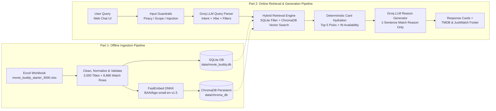
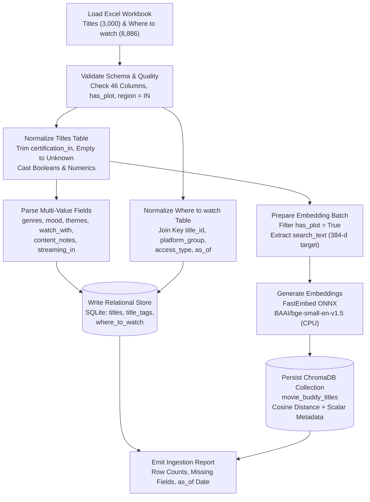
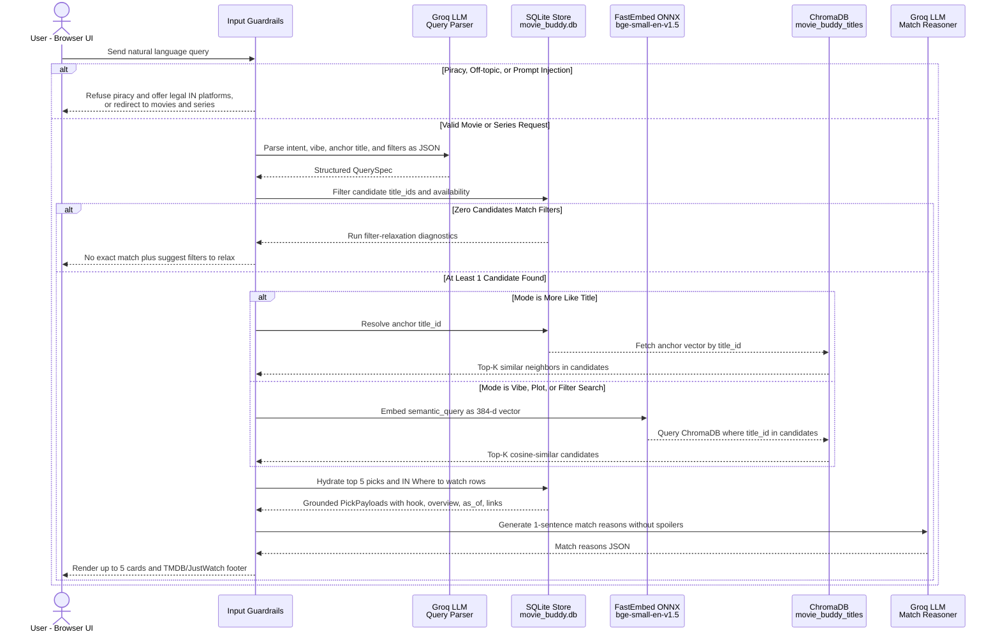
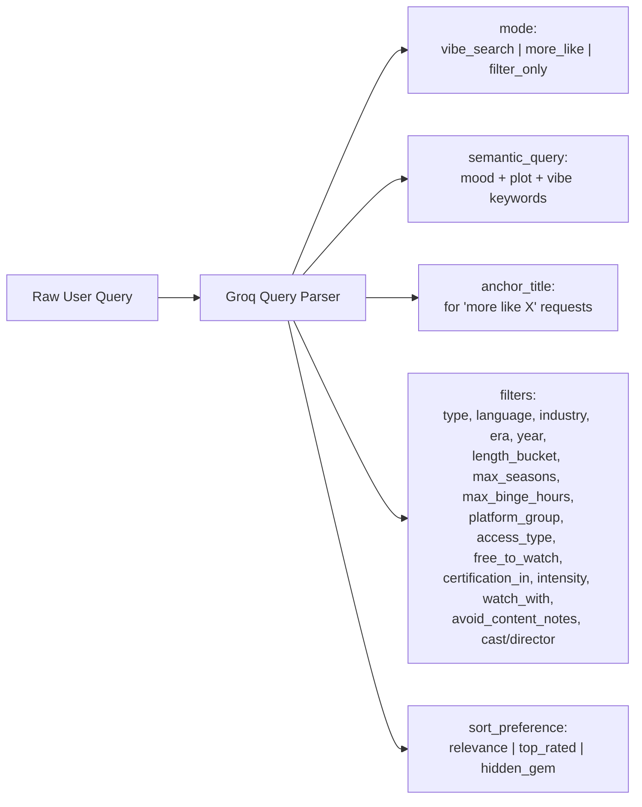
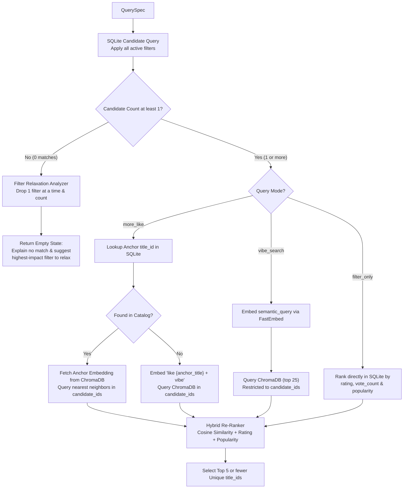

# Movie Buddy — System Architecture

This document defines the end-to-end architecture for **Movie Buddy**, a vibe-based movie and series RAG chatbot for India, derived from [problemStatement.md](file:///Users/darshan/Desktop/Elite%20AI%20Labs/Projects%20-%20Movie/docs/problemStatement.md).

The system is split into two distinct pipelines:
1. **Part 1 — Offline Ingestion Pipeline:** Parses the single Excel source, cleans and normalizes all 46 columns, builds a relational SQLite store for exact metadata/availability filtering, computes ONNX embeddings via `FastEmbed`, and persists them to `ChromaDB`.
2. **Part 2 — Online Retrieval & Generation Pipeline:** Processes natural-language queries with guardrails, extracts structured filters via Groq, executes hybrid SQLite + `ChromaDB` retrieval (including `"more like <title>"` vector lookup and progressive filter relaxation), and renders deterministic, spoiler-free recommendation cards in under 5 seconds within a 512 MB RAM budget.

---

## High-Level System Overview



---

## Part 1: Offline Ingestion Pipeline

The offline pipeline runs **before deployment** (locally or during the Render build step) so the live web server never parses `.xlsx` files or computes 3,000 document embeddings at runtime—critical for staying well under the **512 MB RAM** limit on Render's free tier.

### 1.1 Offline Ingestion Flow



### 1.2 Stage-by-Stage Responsibilities

#### Stage 1: Workbook Loading & Schema Validation
- **Input:** `data/movie_buddy_starter_3000.xlsx` (workspace file: `movie_buddy_starter_3000 (1).xlsx`).
- **Library choice:** `openpyxl` in `read_only=True` mode (only used offline; not required in the runtime server if pre-built artifacts are committed/cached, keeping runtime dependencies minimal).
- **Validation checks:**
  - Verify `Titles` contains all 39 expected columns and `Where to watch` contains all 7 expected columns from `Data dictionary`.
  - Verify every `title_id` in `Where to watch` resolves to a valid `title_id` in `Titles`.
  - Verify `has_plot` and flag any rows without an English plot (`has_plot == False`).
  - Record `data_as_of` and `as_of` dates (`2026-11-21` in the starter dataset) for freshness verification.

#### Stage 2: Cleaning & Normalization Rules
Inspecting the starter dataset reveals specific data hygiene requirements that must run deterministically during ingestion:
- **`certification_in`:** Often empty (`1,226` rows) or contains trailing spaces (`"UA "`). Ingestion must `.strip()` whitespace and map empty/`None` values to `"Unknown"`—never inferring safe or unsafe.
- **Boolean coercion:** `free_to_watch` and `has_plot` may arrive as `"0"`/`"1"` strings or Excel booleans; coerce strictly to `0`/`1` integers (SQLite) and `bool` (ChromaDB).
- **Numeric coercion:** Cast `release_year`, `runtime_min`, `seasons`, `episodes`, `vote_count` to `int` (nullable for movie-only/series-only fields) and `binge_hours`, `rating`, `popularity` to `float`.
- **Series vs. Movie fields:** `seasons`, `episodes`, `binge_hours`, and `status` apply only to `type == "Series"` (`523` rows); preserve `NULL` for `type == "Movie"` (`2,477` rows).
- **Multi-value fields:** Split comma-separated fields (`genres`, `keywords`, `mood`, `themes`, `watch_with`, `content_notes`, `streaming_in`, `director_or_creator`, `top_cast`) cleanly into normalized tag records while keeping the raw display string on the `titles` row.

#### Stage 3: Dual-Store Persistence (`SQLite` + `ChromaDB`)
ChromaDB's `where` metadata filter supports flat scalar equality/range comparisons (`$eq`, `$in`, `$gte`, `$lte`) but cannot natively perform relational joins or multi-value `CONTAINS` queries on comma-separated fields like `watch_with`, `content_notes`, or `(platform_group, access_type)` pairs in `Where to watch`. Splitting storage solves this cleanly:

1. **Relational Store (`data/movie_buddy.db` via Python stdlib `sqlite3`):**
   - `titles` table: All 39 columns from `Titles` indexed on `title_id`, `type`, `language`, `industry`, `release_year`, `era`, `length_bucket`, `certification_in`, `intensity`, `free_to_watch`, `rating`.
   - `title_tags` table: Normalized `(title_id, tag_type, tag_value)` rows for `genres`, `mood`, `themes`, `watch_with`, `content_notes`, `director_or_creator`, and `top_cast`, with composite index `(tag_type, tag_value, title_id)`.
   - `where_to_watch` table: All 7 columns from `Where to watch` (`title_id`, `title`, `platform`, `platform_group`, `access_type`, `region`, `as_of`), indexed on `(title_id)` and `(platform_group, access_type)`.
   - `titles_fts` (optional SQLite FTS5 virtual table): Enables fast exact/fuzzy title lookup for `"more like <title>"` and actor/director name matching.

2. **Vector Store (`data/chroma_db` via `ChromaDB`):**
   - Collection name: `movie_buddy_titles` with HNSW cosine distance (`"hnsw:space": "cosine"`).
   - **Document ID:** `title_id` (e.g., `m_1726`, `tv_1399`).
   - **Embedded Text:** `search_text` column verbatim (built from title, year, language, type, genres, keywords, hook, and overview).
   - **Embedding Model:** `fastembed.TextEmbedding(model_name="BAAI/bge-small-en-v1.5")` (384 dimensions, ONNX runtime, no PyTorch).
   - **Stored Metadata:** Lightweight scalars (`title_id`, `type`, `language`, `industry`, `era`, `release_year`, `intensity`, `free_to_watch`, `rating`, `has_plot`) to support optional fast pre-filtering inside ChromaDB as well.

---

## Part 2: Online Retrieval & Generation Pipeline

The online pipeline runs inside a lightweight Python 3.11 web application (e.g., FastAPI + server-rendered/lightweight frontend or Streamlit/Gradio—FastAPI + minimal HTML/JS is preferred to minimize RAM usage under 512 MB).

### 2.1 Online Request Sequence



### 2.2 Detailed Online Components

#### Step 1: Input Guardrails (Deterministic + Prompt-Level)
Before any retrieval or generation:
- **Piracy Detection:** Regex/keyword pre-filter + LLM intent check for terms like `torrent`, `magnet`, `download free`, `telegram link`, `pirate`, `camrip`, `mkv`. Returns an immediate refusal explaining that Movie Buddy only supports legal viewing in India and offers legal streaming/rental options from the catalog if a title was mentioned.
- **Topic Scope & Prompt Injection Defense:** System prompts treat user text strictly as untrusted data inside delimited `<user_query>` tags. Instructions attempting to override rules ("ignore previous instructions", "act as", "reveal system prompt") are ignored, and non-movie/series requests receive a polite redirect.

#### Step 2: Structured Query Parsing (Groq Free Tier)
A single fast Groq call (e.g., `llama-3.1-8b-instant` or `llama-3.3-70b-versatile` with JSON output) converts the user's message into a typed `QuerySpec`:



- **Vocabulary Alignment:** The parser prompt includes the exact canonical filter values from the dataset (`industry`, `era`, `length_bucket`, `intensity`, `watch_with`, `content_notes`, `platform_group`, `access_type`) so natural language like `"short 90s Bollywood film to watch with parents on Prime"` maps accurately to:
  - `type = "Movie"`, `era = "1990s"`, `industry = "Bollywood"`, `length_bucket = "Under 1.5 hrs"`, `watch_with = "Family"`, `platform_group = "Amazon Prime Video"`.
- **Safety Mapping for `watch_with = "Family"` or `"Kids"`:**
  - Automatically excludes `certification_in == "A"` and sensitive `content_notes` (`Adults only (A)`, `Gore`, `Sexual content`).
  - Respects the Data Dictionary rule: `certification_in == "Unknown"` is **never** assumed safe when the user explicitly requests a safe/U-rated or kid-friendly pick.

#### Step 3: Hybrid Retrieval & Filter Relaxation



- **Why Filter-First + Vector-Rank Works Best:**
  - Filtering 3,000 rows in SQLite takes **< 2 ms** and guarantees hard constraints (language, platform, free-to-watch, avoid-list, runtime) are never violated.
  - Passing `where={"title_id": {"$in": candidate_ids}}` (or intersecting top-100 Chroma results when `len(candidate_ids)` is large) guarantees semantic relevance without losing strict filter compliance.
- **Hidden Gems vs. Popular Picks:**
  - Default scoring blends semantic cosine similarity (`0.75`) + Bayesian-weighted rating (`0.25`, using `rating` and `vote_count`).
  - When user asks for `"hidden gems"` or `"underrated"`, boost high `rating` (`>= 7.5`) with lower `popularity` percentile.
- **Progressive Filter Relaxation:**
  - If strict filters return 0 rows, run single-filter ablation checks in SQLite (each takes < 1 ms) to report e.g.: *"No Korean light comedies are currently free on JioHotstar. Relaxing **Free to watch** gives 4 matches on Netflix/Prime Video, or relaxing **Platform** gives 6 matches."*

#### Step 4: Grounded Hydration & Spoiler-Free Generation
- **Deterministic Hydration (Zero Hallucination Layer):**
  - Fetch full metadata for the top ≤ 5 `title_id`s from `titles` and all matching `IN` availability rows from `where_to_watch`.
  - Construct the pick cards directly from database fields:
    - `title`, `release_year`, `language`, `type`
    - `runtime_min` (if `Movie`) or `seasons` (if `Series`)
    - `rating`, `hook`, `poster_url`, `tmdb_url`
    - `where_to_watch` entries grouped by `access_type` (`Subscription`, `Free`, `Free with ads`, `Rent`, `Buy`) with `platform` and `as_of` date
- **LLM Match Explanation (Groq Free Tier):**
  - Pass only the user's request and each pick's `title`, `genres`, `mood`, `themes`, `hook`, and `overview`.
  - Instruct the LLM to output **one concise sentence per pick** explaining *why it matches the vibe/request*, strictly using `hook` and `overview` with **zero spoilers** (no plot twists or endings).

#### Step 5: UI Layout & Attribution
- **Welcome State:** Greeting explaining Movie Buddy + **4 clickable example prompt chips** (e.g., *Free Hindi comedy to watch with family*, *Mind-bending sci-fi like Inception*, *Short Korean feel-good series on Netflix*, *90s Bollywood romance under 2.5 hrs*).
- **Results Area:** Up to 5 structured **recommendation cards** showing poster, title, year, language, type, runtime/seasons, rating, one-line hook, one-sentence match reason, Indian streaming/rental badges with access type + `as_of` date, and clickable `TMDB` link (`watch_page_url` / `imdb_url` optional secondary links).
- **Mandatory Footer (verbatim):**
  > `This product uses the TMDB API but is not endorsed or certified by TMDB. Streaming availability by JustWatch.`

---

## 3. Resource & Latency Budgets (Render Free Tier)

### 3.1 Memory Budget (Limit: 512 MB RAM)

| Component | Estimated RAM | Optimization Strategy |
|---|---|---|
| Python 3.11 + FastAPI + Uvicorn (1 worker) | ~55 MB | Single worker process (`--workers 1`); no heavy frameworks like Pandas in runtime |
| `FastEmbed` (`BAAI/bge-small-en-v1.5` ONNX) | ~130–160 MB | Quantized/ONNX runtime; loaded once as app singleton; no PyTorch or `sentence-transformers` |
| `ChromaDB` (local persistent, 3,000 × 384-d vectors) | ~60–90 MB | Compact HNSW index for 3,000 rows only |
| `SQLite` (`movie_buddy.db`) + `groq` HTTP client | ~20 MB | Disk-backed SQLite queries with indexed lookups |
| **Total Steady-State Runtime RAM** | **~265–325 MB** | **~185+ MB safety headroom under 512 MB** |

### 3.2 Warm Latency Budget (Target: < 5.0 seconds)

| Stage | Target Latency | Notes |
|---|---|---|
| Input guardrail + Groq Query Parser | ~400–800 ms | Fast Groq model (`llama-3.1-8b-instant`) with compact JSON schema |
| SQLite filtering (+ relaxation check if 0) | < 5 ms | Local indexed queries on 3,000 / 8,886 rows |
| `FastEmbed` query embedding (384-d) | ~20–50 ms | Single short query string on pre-loaded ONNX session |
| `ChromaDB` vector search + hydration | ~15–40 ms | In-process local persistent client |
| Groq Match Reason generation (≤ 5 picks) | ~600–1,200 ms | Short JSON output (5 single-sentence reasons) |
| **Total Warm End-to-End Latency** | **~1.1–2.1 seconds** | Well within the **< 5 seconds** SLA |

---

## 4. Proposed Repository Structure

```text
Projects - Movie/
├── data/
│   ├── movie_buddy_starter_3000.xlsx   # Single source of truth
│   ├── movie_buddy.db                  # Generated by offline ingestion (SQLite)
│   └── chroma_db/                      # Generated by offline ingestion (ChromaDB)
├── docs/
│   ├── problemStatement.md             # Full requirements & 46-column data dictionary
│   └── architecture.md                 # This architecture specification
├── src/
│   ├── ingest.py                       # Part 1: Offline ingestion script
│   ├── config.py                       # Env vars (.env), paths, constants
│   ├── guardrails.py                   # Piracy, scope, prompt-injection checks
│   ├── query_parser.py                 # Groq structured filter & vibe extractor
│   ├── retriever.py                    # Part 2: Hybrid SQLite + ChromaDB retriever
│   ├── responder.py                    # Grounded card hydration + match reasons
│   └── app.py                          # FastAPI web server + UI routes
├── tests/
│   └── eval_20_questions.py            # Phase 8: 20-question evaluation suite
├── .env.example                        # GROQ_API_KEY placeholder (never commit .env)
└── requirements.txt                    # Python 3.11 minimal dependencies
```
