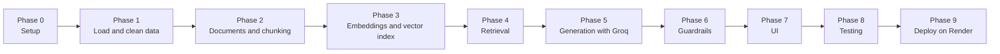

# Movie Buddy — Phase-Wise Implementation Plan

This implementation plan breaks down the build of **Movie Buddy** into **10 sequential phases (Phase 0 – Phase 9)** based on [problemStatement.md](file:///Users/darshan/Desktop/Elite%20AI%20Labs/Projects%20-%20Movie/docs/problemStatement.md) and [architecture.md](file:///Users/darshan/Desktop/Elite%20AI%20Labs/Projects%20-%20Movie/docs/architecture.md).

---

## Phase 0: Setup

### Goal
Establish a clean, reproducible Python 3.11 project environment, repository structure, dependency constraints, and secret management compliant with Render's free tier (512 MB RAM) and zero-paid-API policy.

### Tasks
1. Verify Python 3.11 runtime and initialize a local virtual environment (`.venv`).
2. Create the project directory structure (`data/`, `docs/`, `src/`, `tests/`).
3. Place the single source workbook at `data/movie_buddy_starter_3000.xlsx` (copying/renaming from `movie_buddy_starter_3000 (1).xlsx` while keeping data unmodified).
4. Create `requirements.txt` with lightweight, PyTorch-free dependencies (`fastapi`, `uvicorn`, `fastembed`, `chromadb`, `groq`, `openpyxl` for offline ingestion, `pydantic`, `python-dotenv`, `pytest`).
5. Create `.env.example` (`GROQ_API_KEY=...`, `GROQ_MODEL=...`) and `.gitignore` ensuring `.env`, `.venv/`, `__pycache__/`, and transient caches are never committed.
6. Implement `src/config.py` to load environment variables, file paths (`SQLITE_DB_PATH`, `CHROMA_DIR`, `EXCEL_PATH`), and model constants (`BAAI/bge-small-en-v1.5`).

### Deliverables
- Repository folder structure (`data/`, `docs/`, `src/`, `tests/`)
- `requirements.txt`, `.env.example`, `.gitignore`
- `src/config.py`
- Verified `data/movie_buddy_starter_3000.xlsx` in place

### Exit Criteria
- `python --version` reports `3.11.x` inside `.venv`.
- All dependencies install cleanly with **no PyTorch** and **no `sentence-transformers`**.
- `src/config.py` imports without errors and resolves `GROQ_API_KEY` from `.env` (verified without committing secrets).

---

## Phase 1: Load and clean data

### Goal
Parse all sheets from `data/movie_buddy_starter_3000.xlsx`, validate the 46 columns defined in `Data dictionary`, clean data anomalies, and persist normalized relational tables into SQLite (`data/movie_buddy.db`).

### Tasks
1. Implement Excel reader in `src/ingest.py` using `openpyxl` (`read_only=True`, `data_only=True`) to load `Titles` (3,000 rows, 39 columns) and `Where to watch` (8,886 rows, 7 columns).
2. Validate schema completeness against all 46 columns from `Data dictionary` and verify referential integrity (`Where to watch.title_id` exists in `Titles.title_id` and `region == "IN"`).
3. Clean and normalize `Titles` fields:
   - Strip whitespace on `certification_in` (fixes `"UA "`) and map empty/`None` values to `"Unknown"` (never inferring safe/unsafe).
   - Coerce `free_to_watch` and `has_plot` (`"0"`/`"1"` or booleans) to strict `0`/`1` booleans.
   - Cast numeric columns (`release_year`, `runtime_min`, `seasons`, `episodes`, `vote_count` as `int`; `binge_hours`, `rating`, `popularity` as `float`), preserving `NULL` for movie-only/series-only fields.
   - Normalize multi-value comma-separated columns (`genres`, `keywords`, `mood`, `themes`, `watch_with`, `content_notes`, `streaming_in`, `director_or_creator`, `top_cast`).
4. Create SQLite schema in `data/movie_buddy.db`:
   - `titles` (all 39 columns, primary key `title_id`, indexed filter columns)
   - `title_tags` (`title_id`, `tag_type`, `tag_value`, indexed for exact multi-value filtering)
   - `where_to_watch` (all 7 columns, indexed on `title_id` and `(platform_group, access_type)`)
   - `titles_fts` (FTS5 index over `title` and `original_title` for `"more like <title>"` lookups)
5. Log an ingestion audit summary (total titles, movies vs. series count, missing `certification_in` count, `has_plot` check, `data_as_of` and `as_of` dates).

### Deliverables
- Data-cleaning & SQLite builder module in `src/ingest.py`
- Generated relational database `data/movie_buddy.db`
- Ingestion validation summary output

### Exit Criteria
- `titles` table contains exactly **3,000 rows** (2,477 Movies, 523 Series) and `where_to_watch` contains **8,886 rows** (`region = 'IN'`).
- Zero empty/whitespace-corrupted `certification_in` values remain (all empty values stored as `"Unknown"`).
- Sample SQL queries for language, era, platform + access type, and `content_notes` exclusions execute in **< 5 ms**.

---

## Phase 2: Documents and chunking

### Goal
Define and build the **1 title = 1 document** representation for semantic indexing using `data/processed/titles.json`, embedding `search_text` verbatim while reserving multi-value and relational columns for SQLite metadata filtering.

### Tasks
1. Formalize the **1 title = 1 document** chunking strategy (no sub-chunking or sliding windows):
   - Empirical check on `data/processed/titles.json` shows `search_text` spans **10–184 words** (`77–1,103` chars; median `61` words), fitting well within `BAAI/bge-small-en-v1.5`'s **512-token** context window with zero truncation.
   - Keeping one atomic document per `title_id` prevents cross-title context bleed, duplicate top-5 results, and unnecessary ChromaDB index bloat.
2. Separate **embedded text** from **metadata filters**:
   - **Embedded text (`text`):** `search_text` verbatim (`title`, `release_year`, `language`, `type`, `genres`, `keywords`, `hook`, `overview`)—kept pure of rule-generated `mood`/`intensity`/`watch_with`, cast/director names, and URLs.
   - **ChromaDB scalar metadata (`metadata`):** Non-null scalar filters (`title_id`, `type`, `language`, `industry`, `origin_country`, `release_year`, `era`, `certification_in`, `intensity`, `free_to_watch`, `has_plot`, plus non-null `runtime_min`, `length_bucket`, `seasons`, `rating`, `vote_count`, `popularity`).
   - **SQLite relational/multi-value filters (not in Chroma metadata):** Comma-separated tags (`genres`, `mood`, `themes`, `watch_with`, `content_notes`, `director_or_creator`, `top_cast`), nullable series fields (`episodes`, `binge_hours`, `status`), and `where_to_watch` (`platform` via `platform_group`, `access_type`, `region`, `as_of`).
3. Implement `src/documents.py` (`build_documents`) to read `data/processed/titles.json` without altering source data:
   - Gate on `has_plot == True` and non-empty `search_text`.
   - Enforce scalar-only ChromaDB metadata values (`str`, `int`, `float`, `bool`; omit `None`).
   - Map deterministic document IDs (`id = title_id`, e.g., `m_1726`, `tv_1434`).
4. Run a length/token-budget audit across all 3,000 documents and save both `data/processed/documents.jsonl` and pretty-printed `data/processed/documents.json`.

### Deliverables
- `src/documents.py` with `build_documents` and length audit reporting
- `data/processed/documents.jsonl` (JSON Lines for streaming/batch embedding)
- `data/processed/documents.json` (pretty-printed JSON for inspection)
- `tests/test_phase2_documents.py`

### Exit Criteria
- Every document has a unique `id == title_id` matching `data/processed/titles.json` and SQLite, with unmodified `search_text` (`has_plot == True`).
- 100% of document lengths fit cleanly within `BAAI/bge-small-en-v1.5`'s 512-token limit.
- Every `metadata` dictionary contains only ChromaDB-compatible scalar types (`str`, `int`, `float`, `bool`) with zero `None` or nested values.
- Both `data/processed/documents.jsonl` and `data/processed/documents.json` are generated and verified against unit tests.

---

## Phase 3: Embeddings and vector index

### Goal
Generate 384-dimensional ONNX embeddings for all 3,000 prepared documents using `FastEmbed` (`BAAI/bge-small-en-v1.5`) and persist them into a local `ChromaDB` collection.

### Tasks
1. Initialize `fastembed.TextEmbedding(model_name="BAAI/bge-small-en-v1.5")` in the offline ingestion script (ONNX runtime, CPU).
2. Compute embeddings in memory-bounded batches (e.g., batch size `64` or `128`) over the 3,000 documents.
3. Create persistent `chromadb.PersistentClient(path="data/chroma_db")` with collection `movie_buddy_titles` configured for **cosine distance** (`hnsw:space: cosine`).
4. Upsert `(ids, embeddings, documents, metadatas)` into ChromaDB in batches to ensure idempotent re-runs of `src/ingest.py`.
5. Run a sanity check querying 3–5 representative vibes (e.g., `"feel good college friendship"`, `"dark mind-bending time travel thriller"`, `"cozy family comedy"`) and verifying cosine distances and `title_id` alignment with SQLite.

### Deliverables
- Complete offline ingestion CLI (`python -m src.ingest`)
- Persisted vector index under `data/chroma_db/`

### Exit Criteria
- `movie_buddy_titles` collection count equals **3,000**.
- Re-running `python -m src.ingest` is idempotent (still 3,000 records, no duplicates).
- Semantic sanity queries return relevant `title_id`s in **< 50 ms** without PyTorch installed.

---

## Phase 4: Retrieval

### Goal
Build the filter-first hybrid retrieval engine (`src/retriever.py`) combining typo-tolerant query parsing, exact SQLite metadata and `platform_group` filtering, `ChromaDB` semantic/similarity ranking, duplicate-title disambiguation, progressive filter relaxation, and grounded pick hydration.

### Tasks
1. Define `QueryFilters`, `QuerySpec`, `PickPayload`, and `RetrievalResult` Pydantic schemas capturing `mode` (`vibe_search`, `more_like`, `filter_only`), `semantic_query`, `anchor_title`, `anchor_language`, structured `filters`, and `sort_preference` (`relevance`, `top_rated`, `hidden_gem`).
2. Implement typo-tolerant query normalization & rule-based parser (`parse_query_rule_based`, later enhanced by Groq in Phase 5):
   - Canonicalize misspelled language names (`kanada` → `Kannada`, `hindhi` → `Hindi`, `malyalam` → `Malayalam`, `telegu` → `Telugu`, etc.) via explicit aliases + fuzzy matching.
   - Map platform aliases (`hotstar` → `JioHotstar`, `prime` → `Amazon Prime Video`, `sony liv` → `SonyLIV`, etc.) strictly to `platform_group` values.
3. Implement **Filter-First SQLite Candidate Filtering**:
   - Filter first in SQLite (`< 2 ms`) across `type`, `language`, `industry`, `era`, `release_year` ranges, `runtime_min` / `length_bucket`, `seasons`, `binge_hours`, `status`, `certification_in`, `intensity`, `watch_with` (including `"Anyone"`), `genres`, `mood`, `themes`, `avoid_content_notes`, `free_to_watch`, `platform_group`, `access_type`, and `rating`.
   - **Certificate rule:** Never drop a title solely because `certification_in` is empty (`"Unknown"`).
4. Implement **Vector Retrieval & `"More Like <Title>"` Mode**:
   - Load `FastEmbed` and `ChromaDB` lazily as singletons.
   - For `vibe_search`: embed `semantic_query` and rank SQLite `candidate_ids` via ChromaDB (`$in` when `<= 200` candidates, or broad Chroma query + intersection when `> 200`).
   - For `more_like`: look up `anchor_title` in SQLite. If multiple titles share the same name (e.g., `Drishyam`, `Leo`, `War of the Worlds`), prefer the language/year mentioned by the user; otherwise return a clarification prompt asking which one they meant. Once resolved, fetch the anchor title's **stored 384-d embedding** from ChromaDB and rank nearest neighbors excluding the anchor itself (falling back to text embedding if out-of-catalog).
   - For `filter_only`: rank SQLite candidates directly by Bayesian-weighted rating + popularity.
5. Implement **Hybrid Re-Ranking & Top-5 Selection**:
   - Blend cosine similarity (`0.75`) with Bayesian-weighted `rating` / `vote_count` (`0.25`), plus hidden-gem boost when requested; cap at `<= 5` picks without padding missing slots.
6. Implement **Progressive Filter Relaxation & Deterministic Hydration**:
   - When `0` candidates match, run single-filter ablation in SQLite to report which filter(s) unlock matches.
   - Hydrate selected `title_id`s with exact `Titles` metadata and deduplicated `where_to_watch` (`platform_group`, `access_type`, `as_of`).

### Deliverables
- `src/retriever.py` with `QuerySpec`, `RetrievalResult`, `PickPayload`, typo-tolerant parser, SQLite filter engine, ChromaDB hybrid ranker, `"more like"` anchor-embedding lookup, disambiguation, relaxation analyzer, and QA runner
- `tests/test_phase4_retrieval.py`

### Exit Criteria
- Hybrid filter+vibe queries (e.g., `'light Kannada or Hindi film under 2 hours, free to watch'`), language typos (`kanada`, `hindhi`), `platform_group` filters, and `"more like <title>"` queries return `<= 5` grounded `PickPayload`s matching all active filters, printing parsed filters for every test query.
- Shared-name titles (`Drishyam`, `Leo`) disambiguate when language is mentioned or return a clarification prompt asking which one.
- Empty `certification_in` (`"Unknown"`) titles are never dropped solely due to missing certificate.
- Over-constrained queries return `0` picks plus actionable filter-relaxation suggestions.
- Retrieval + hydration completes in **< 100 ms** warm.

---

## Phase 5: Generation with Groq

### Goal
Integrate the Groq free-tier LLM for (1) structured natural-language query parsing (`src/query_parser.py`) and (2) spoiler-free, strictly grounded recommendation explanations (`src/responder.py`).

### Tasks
1. Implement `src/query_parser.py` using the `groq` Python SDK with JSON mode / structured output:
   - Map natural-language phrases (e.g., `"90s"`, `"short movie"`, `"under 1.5 hrs"`, `"bingeable weekend series"`, `"free on YouTube or MX Player"`, `"avoid gore"`, `"watching with parents"`, `"hidden gem"`) to exact canonical dataset values.
   - Support multi-turn conversational context (e.g., follow-ups like `"make it Hindi instead"` or `"only free ones"`).
2. Implement `src/responder.py` to generate:
   - A concise conversational summary/intro.
   - **Exactly one sentence per pick** explaining why it matches the user's vibe/filters, strictly grounded in `hook`, `overview`, `genres`, `mood`, and `themes`—with **zero spoilers**.
   - Helpful empty-state messages using the Phase 4 filter-relaxation diagnostics when 0 titles match.
3. Ensure deterministic rendering of all factual fields (`title`, `release_year`, `language`, `type`, `runtime_min`/`seasons`, `rating`, `hook`, `where_to_watch` platforms + `access_type` + `as_of` date, `tmdb_url`) directly from `PickPayload` rather than LLM prose.
4. Log every Groq call with HTTP status code, model, latency, and token counts (`prompt_tokens`, `completion_tokens`, `total_tokens`), and enforce `max_tokens >= 1024` for reasoning models.
5. **Strict Error Visibility (No Silent Fallback):** Do NOT silently fall back to offline heuristics or mock responses when Groq fails; surface a clear, actionable error message to the user.

### Deliverables
- `src/query_parser.py`
- `src/responder.py`

### Exit Criteria
- Natural-language prompts parse reliably into valid `QuerySpec` JSON objects.
- Every generated pick response contains all required fields from `problemStatement.md`, a 1-sentence spoiler-free match reason, and zero invented titles, ratings, years, or platforms.
- End-to-end Parse + Retrieve + Generate latency is **< 3.5 seconds** on warm requests.

---

## Phase 6: Guardrails

### Goal
Enforce all safety, scope, anti-piracy, prompt-injection, grounding, and data-freshness guardrails across input, retrieval, and output layers.

### Tasks
1. Implement `src/guardrails.py` for pre-LLM and post-LLM checks:
   - **Anti-Piracy Gate:** Detect piracy/download/torrent/free-link-for-paid-film requests; refuse clearly and offer legal Indian platforms (or show legal availability if a catalog title was named).
   - **Topic Scope Gate:** Reject off-topic requests (coding, homework, politics, medical advice, etc.) and steer back to movie/series recommendations.
   - **Prompt Injection Defense:** Wrap user input in explicit untrusted delimiters in Groq prompts, enforce strict JSON schemas, and strip/ignore instructions attempting to override system rules or leak prompts.
   - **No-Hallucination Output Validator:** Assert every `title_id`, `title`, `release_year`, `rating`, `platform`, `access_type`, `as_of`, and `tmdb_url` in the final response exists in the hydrated `PickPayload`s from SQLite.
   - **Empty Certificate & Content Avoidance Enforcement:** Verify `certification_in == "Unknown"` is never treated as safe when safe-only/U-rated content is requested, and verify `avoid_content_notes` exclusions are honored.
   - **Freshness & Spoiler Check:** Ensure `as_of` date is always displayed alongside watch options and LLM prompt explicitly forbids endings/twist disclosures.

### Deliverables
- `src/guardrails.py`
- Integrated guardrail hooks in `src/app.py`, `src/query_parser.py`, `src/retriever.py`, and `src/responder.py`

### Exit Criteria
- Piracy prompts are refused and redirected to legal platforms.
- Prompt-injection attempts fail to alter system rules or output non-catalog titles.
- Off-topic prompts are politely declined.
- Output validator passes 100% of checks with zero ungrounded fields.

---

## Phase 7: UI

### Goal
Build a fast, lightweight web interface (`src/app.py` + static HTML/CSS/JS) that meets every UI requirement from `problemStatement.md` while keeping runtime RAM minimal.

### Tasks
1. Build FastAPI backend (`src/app.py`) with:
   - `GET /` serving the web UI
   - `POST /api/chat` accepting user query (+ optional conversation history) and returning structured recommendation cards + assistant message
   - `GET /health` endpoint for Render health checks (confirming SQLite, ChromaDB, and FastEmbed singleton readiness)
2. Build the frontend UI containing all required elements:
   - **Welcome message** introducing Movie Buddy
   - **4 clickable example prompts** covering diverse vibes and filters (e.g., family comedy, `"more like ..."`, regional language/platform, free to watch)
   - **Chat box** with loading indicator and clear error/empty-state rendering
   - **Recommendation cards** (up to 5) displaying: poster thumbnail (`poster_url` with graceful fallback), title, `release_year`, `language`, `type`, runtime (`runtime_min`) or `seasons`, `rating`, one-line `hook`, one-sentence match reason, India legal watch badges (`platform` + `access_type` + `as_of` date), and clickable `TMDB` link (`tmdb_url`, plus optional `watch_page_url`)
   - **Mandatory Footer (verbatim):**
     `This product uses the TMDB API but is not endorsed or certified by TMDB. Streaming availability by JustWatch.`
3. Ensure responsive layout for mobile and desktop browsers (college-student friendly).

### Deliverables
- `src/app.py` (FastAPI endpoints + startup lifespan singleton loader)
- Frontend templates/assets (`static/` or `templates/`)

### Exit Criteria
- Welcome message, 4 example prompts, chat box, result cards, and exact TMDB/JustWatch footer are all visible and functional in the browser.
- Every card displays all required pick fields (`title`, `year`, `language`, `type`, `runtime`/`seasons`, `rating`, `hook`, 1-sentence match reason, India watch options with `access_type` & `as_of`, and `tmdb_url`).
- `/health` returns `200 OK`.

---

## Phase 8: Testing

### Goal
Verify functional accuracy, guardrail resilience, latency (< 5s warm), and memory footprint (< 512 MB RAM) against a comprehensive **20-question evaluation suite** plus unit/integration tests.

### Tasks
1. Create unit tests (`tests/test_pipeline.py`) covering:
   - Data cleaning (`certification_in == "Unknown"`, boolean/numeric casts)
   - SQLite filter accuracy (language, industry, era, length, platform, `access_type`, `free_to_watch`, `watch_with`, `avoid_content_notes`)
   - `"More like <title>"` retrieval & progressive filter relaxation
   - Guardrail unit tests (piracy, prompt injection, off-topic, hallucination validator)
2. Create the **20-question Phase 8 evaluation suite** (`tests/eval_20_questions.py`) covering:
   - Mood & plot vibe queries
   - `"More like <title>"` queries
   - Multi-filter queries (language + era + length + platform + `watch_with`)
   - Free-to-watch & specific Indian OTT queries (JioHotstar, Netflix, Prime Video, ZEE5, SonyLIV, aha, Sun NXT, YouTube)
   - Content-avoidance & family/certificate safety queries
   - Impossible/zero-match queries (verifying relaxation suggestions)
   - Guardrail adversarial prompts (piracy, prompt injection, off-topic)
3. Measure warm p50/p95 end-to-end response latency and peak process RSS memory locally to confirm compliance with `< 5s` latency and `< 512 MB` RAM.
4. Fix any retrieval, parsing, or prompt edge cases uncovered during the 20-question run.

### Deliverables
- `tests/test_pipeline.py`
- `tests/eval_20_questions.py`
- Evaluation report showing pass/fail, latency, and RAM usage across all 20 questions

### Exit Criteria
- **20 / 20 test questions pass** in Phase 8 evaluation.
- All unit and guardrail tests pass.
- Warm response time is **< 5 seconds** across all evaluation queries.
- Peak RSS memory stays comfortably below **512 MB** (target ≤ 350 MB).

---

## Phase 9: Deploy on Render

### Goal
Deploy Movie Buddy to a public Render free web service (`512 MB RAM`), verify live health and latency, and confirm the production app passes end-to-end checks.

### Tasks
1. Prepare deployment configuration (`render.yaml` or Render dashboard settings + `Dockerfile` / Python 3.11 build & start commands):
   - Build command: `pip install -r requirements.txt` (and run `python -m src.ingest` if pre-built `data/movie_buddy.db` and `data/chroma_db/` are not committed, or verify pre-built artifacts are bundled cleanly).
   - Start command: `uvicorn src.app:app --host 0.0.0.0 --port $PORT --workers 1`
2. Configure `GROQ_API_KEY` and any environment variables securely in Render's Environment dashboard (never in Git).
3. Push repository to GitHub (verifying `.env` is excluded) and trigger Render deploy.
4. Monitor Render build logs and runtime memory metrics; pre-warm the `/health` endpoint and verify `FastEmbed` model cache + `ChromaDB` load cleanly within 512 MB RAM.
5. Run live smoke tests on the public Render URL (including example prompts, filter queries, piracy guardrail check, card rendering, footer verification, and warm response time < 5s).

### Deliverables
- `render.yaml` (or documented Render build/start configuration)
- Live public Render URL serving Movie Buddy

### Exit Criteria
- App builds and boots cleanly on Render free web service without OOM errors (< 512 MB RAM).
- Public Render URL is live and accessible.
- Warm queries on the live Render deployment respond in **< 5 seconds** with accurate cards, legal Indian watch options, `as_of` dates, TMDB links, and required footer.
